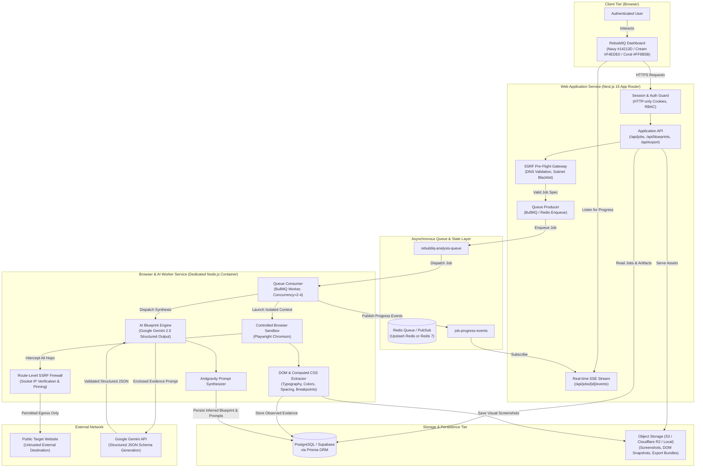

# RebuildIQ: Comprehensive Technical Architecture Specification

## 1. Executive Summary & Architectural Mission

RebuildIQ is an AI-powered website analysis and reconstruction-planning SaaS platform. It enables engineers, technical product managers, and designers to inspect publicly accessible websites, extract visual and structural design evidence using controlled browser automation, and generate production-grade reconstruction blueprints alongside implementation prompts for AI coding tools like Antigravity, Claude Code, and Cursor.

### Core Architectural Axioms
1. **Decoupled Web & Worker Architecture:** Frontend serverless hosting (e.g., Vercel, Netlify) cannot securely, reliably, or economically execute long-running, memory-heavy headless browser processes. The Web Application (UI, API, Auth, Enqueuing) and Browser Worker (Chromium, SSRF Firewall, DOM/Style Extractor) run as distinct services communicating asynchronously via a durable queue and shared persistence.
2. **Strict Ground Truth Separation:** Observed evidence (DOM hierarchy, computed typography, CSS layout, viewport screenshots, HTTP headers) is stored and presented as immutable empirical facts. AI analysis (component boundaries, suggested modern architecture, state management recommendations) is explicitly categorized as inference.
3. **Defense-in-Depth for Untrusted Inputs:** All target URLs and inspected web content are treated as potentially hostile inputs. Strict network-level SSRF defenses, DNS rebinding mitigations, browser process isolation, and prompt injection fences protect both internal infrastructure and the AI synthesis pipeline.

---

## 2. High-Level System Architecture & Service Topology



---

## 3. The 15 Architectural Domain Definitions

### 3.1 Frontend Architecture
- **Framework & Runtime:** Next.js 15 (App Router), React 19, TypeScript 5.6+.
- **Design System Tokens:** Strict enforcement of the brand palette:
  - **Navy (`#14213D`):** Structural chrome, deep typography, code viewports, and primary surfaces.
  - **Cream (`#F4EDE0`):** Warm primary canvas, card containers, subtle borders (`#E2D7C3`).
  - **Coral (`#FF6B5B`):** Deliberate focal accents, interactive triggers, progress bars, and active badges.
- **Component Primitives:** Built with clean Radix UI headless primitives and Tailwind CSS utility tokens. Zero glassmorphism, no neon colors, no excessive gradients.
- **State Management:**
  - *Server State:* React Server Components (RSC) for initial page loads; TanStack Query / SWR for client-side caching.
  - *Real-Time State:* Custom `useAnalysisProgress(jobId)` hook listening to Server-Sent Events (SSE) with automatic reconnection.
  - *Form & UI State:* React Hook Form + Zod resolvers.
- **Key Views:**
  1. `/dashboard`: Metric cards, active job progress, historical analysis table with multi-tenant filtering.
  2. `/analysis/new`: Pre-flight validated URL input, viewport selection (Mobile 375px, Tablet 768px, Desktop 1280px), crawl depth slider (1–5 pages).
  3. `/analysis/[id]`: Multi-tab inspector:
     - *Overview:* Job status, execution timing, target metadata.
     - *Evidence (Observed Ground Truth):* Computed typography tables, palette swatches with hex/luminance values, spacing scales, DOM semantic hierarchy viewer, responsive screenshots.
     - *Blueprint (Inferred Architecture):* Component hierarchy tree, design system CSS variable definitions, state/interaction models, modern tech stack recommendations.
     - *Antigravity Prompts:* Copy-paste ready implementation prompts with syntax highlighting.
  4. `/analysis/[id]/export`: Interactive export modal with multi-format download capabilities.

### 3.2 Backend API Architecture
- **API Model:** RESTful JSON endpoints and Server-Sent Events (SSE) implemented via Next.js Route Handlers (`app/api/`).
- **Standard Envelope:**
  ```typescript
  export type ApiResponse<T> = 
    | { success: true; data: T; meta?: Record<string, unknown> }
    | { success: false; error: { code: string; message: string; details?: unknown } };
  ```
- **Trust Boundary Schema Validation:** All request payloads and query parameters are parsed using strict Zod schemas before touching application logic.
- **Route Catalog:**
  - `POST /api/auth/register` & `POST /api/auth/login`: User onboarding and session issuance.
  - `GET /api/auth/me`: Authenticated user profile retrieval.
  - `POST /api/jobs`: Submit and validate a new website analysis job.
  - `GET /api/jobs`: Paginated list of analyses owned by the authenticated user.
  - `GET /api/jobs/:id`: Detailed job record including observed evidence and generated blueprints.
  - `DELETE /api/jobs/:id`: Delete an analysis job and its associated screenshot artifacts.
  - `POST /api/jobs/:id/cancel`: Signal job cancellation to the background worker.
  - `GET /api/jobs/:id/events`: Real-time Server-Sent Events stream for live progress tracking.
  - `GET /api/jobs/:id/export?format=(json|markdown|zip)`: Multi-format artifact bundle export.
  - `GET /api/health`: Health check probing database connectivity and Redis availability.

### 3.3 Authentication & Authorization
- **Session Architecture:** Secure, HTTP-only, `SameSite=Lax`, `Secure` (in production) cookies storing a cryptographically signed session token.
- **Authentication Provider Evaluation:**
  - *Option A: Standalone Session Auth (Prisma-backed):* Self-contained, zero third-party lock-in, PBKDF2/Argon2 password hashing, full control over session schema.
  - *Option B: Supabase Auth / Auth0:* Managed OAuth, magic links, but introduces external network latency and billing tiers.
  - *Architectural Decision:* **Hybrid approach.** Implement a clean, self-contained Prisma-based session authentication system by default (for zero-friction local and Docker deployments), with direct architectural mapping to Supabase Auth / JWT verification for cloud deployments.
- **Authorization & Data Isolation:**
  - Strict multi-tenancy: Every `AnalysisJob` entity has a non-nullable `userId` foreign key.
  - All database queries enforce `WHERE userId = session.userId`.
  - Unauthorized requests to another user's job return `404 Not Found` (rather than `403 Forbidden`) to prevent resource enumeration attacks.

### 3.4 Database & Data Ownership
- **ORM & Dialect:** PostgreSQL accessed via Prisma ORM. (SQLite supported in local dev/testing for zero-dependency development).
- **Core Entities:**
  - `User`: Identity, email, password hash, role (`USER`, `ADMIN`), creation timestamps.
  - `Session`: Active sessions, token hashes, user agent, expiration.
  - `AnalysisJob`: Job lifecycle status, target URL, normalized domain, crawl options, timings, error codes, foreign key to `User`.
  - `PageEvidence`: Ground truth DOM tree (JSON), computed typography (JSON), computed colors (JSON), layout metrics (JSON), foreign key to `AnalysisJob`.
  - `VisualScreenshot`: Viewport type (`MOBILE`, `TABLET`, `DESKTOP`), dimensions, file storage path, sha256 hash, foreign key to `PageEvidence`.
  - `BlueprintArtifact`: Inferred component hierarchy (JSON), design system spec (JSON), recommended stack (JSON), Antigravity prompt markdown (Text), foreign key to `AnalysisJob`.
- **Referential Integrity & Cascading:** Deleting an `AnalysisJob` cascades deletions to `PageEvidence`, `VisualScreenshot`, and `BlueprintArtifact`.

### 3.5 Website-Analysis Job Orchestration
- **State Machine Lifecycle:**
  ```mermaid
  stateDiagram-v2
      [*] --> PENDING: User Submits URL
      PENDING --> VALIDATING: Pre-Flight SSRF & DNS Check
      VALIDATING --> QUEUED: Hostname Resolves to Allowed Public IP
      VALIDATING --> FAILED: Private IP / Malformed / SSRF Blocked
      QUEUED --> INSPECTING: Worker Claims Job
      INSPECTING --> EXTRACTING_EVIDENCE: Chromium Loads Page & Intercepts Egress
      EXTRACTING_EVIDENCE --> ANALYZING_AI: Evidence Stored in DB
      ANALYZING_AI --> GENERATING_BLUEPRINT: Gemini Synthesizes Architecture
      GENERATING_BLUEPRINT --> COMPLETED: Blueprints & Antigravity Prompts Persisted
      INSPECTING --> FAILED: Browser Crash / Timeout (30s) / DNS Rebinding
      EXTRACTING_EVIDENCE --> FAILED: DOM Extraction Error
      ANALYZING_AI --> FAILED: AI Provider Rate Limit / Validation Error
      QUEUED --> CANCELLED: User Aborts Job
      INSPECTING --> CANCELLED: Cancellation Token Received
  ```
- **Timeouts & Limits:**
  - Pre-flight DNS check: 3 seconds.
  - Page navigation timeout: 30 seconds.
  - Browser evaluation timeout: 10 seconds.
  - Overall job timeout: 180 seconds.
  - Bounded retries: 2 retry attempts for transient network timeouts; zero retries for SSRF blocks or 4xx HTTP responses.

### 3.6 Browser-Worker Architecture
- **Runtime Environment:** Dedicated container (Debian Bullseye slim) running Node.js 22 with Google Chromium and Playwright.
- **Process Isolation:**
  - Chromium runs with security-hardening flags:
    `['--disable-gpu', '--disable-local-file-access', '--disable-background-networking', '--disable-default-apps', '--disable-extensions', '--no-sandbox']`
  - Each job is executed inside an ephemeral `BrowserContext` with dedicated cookie jar and local storage, wiped immediately upon completion.
- **SSRF Network Route Interceptor:**
  - Playwright's `page.route('**/*', async (route) => { ... })` intercepts every HTTP request.
  - The destination IP of every redirect and subresource (scripts, stylesheets, images, iframes) is dynamically resolved and validated against the CIDR blocklist.
  - Any request targeting loopback, private subnets, link-local metadata (`169.254.169.254`), or alternate IP representations is aborted immediately.
- **Resource Extraction Engines:**
  - Pure DOM tree traversal without injecting foreign JavaScript dependencies into the target site.
  - Computed style sampling using `window.getComputedStyle(element)` on visible DOM nodes.
  - Screenshot capture at exact CSS viewports: Mobile (375x812), Tablet (768x1024), Desktop (1280x800).

### 3.7 AI Provider Integration
- **Engine:** Google Gemini API (`gemini-2.5-flash` for high-speed synthesis; `gemini-2.5-pro` for deep component architectures).
- **Structured Output Enforcement:** Uses Gemini native `responseSchema` (adhering to our Zod schema) and `responseMimeType: "application/json"`.
- **Prompt Injection Defense & Untrusted Data Isolation:**
  - Target website text, titles, class names, and attributes are treated strictly as untrusted raw strings.
  - Encapsulated inside structured XML-like boundary tags: `<untrusted_web_evidence>`.
  - System instructions explicitly forbid the model from executing commands, following instructions, or deviating from the JSON schema based on text found inside `<untrusted_web_evidence>`.
- **Fallback / Mock Provider:** Modular interface (`AIProvider`) allowing an offline mock provider that generates realistic, schema-valid blueprints for automated testing and local development without requiring live API keys.

### 3.8 Background Queue & Job Persistence
- **Queue System:** BullMQ backed by a Redis-compatible store (Upstash Redis for serverless/managed environments, or self-hosted Redis 7 in Docker).
- **Web $\to$ Worker Contract:**
  - Web service pushes a lightweight job payload: `{ jobId: string, targetUrl: string, options: JobOptions }`.
  - Worker updates persistent job status directly in PostgreSQL via Prisma, guaranteeing database consistency.
  - Worker publishes real-time progress events (`{ jobId, stage: "INSPECTING", progressPercent: 40 }`) to a Redis Pub/Sub channel.
  - Next.js SSE endpoint subscribes to the Redis channel and streams updates to the client browser.
- **Failure Recovery:** If a worker crashes mid-inspection, BullMQ's stalled job detection marks the job for bounded retry or triggers the `FAILED` state handler, ensuring jobs never remain permanently frozen in `INSPECTING`.

### 3.9 Screenshot & Artifact Storage
- **Storage Abstraction:**
  ```typescript
  export interface StorageService {
    upload(key: string, buffer: Buffer, contentType: string): Promise<string>;
    getDownloadUrl(key: string, expiresInSeconds?: number): Promise<string>;
    delete(key: string): Promise<void>;
  }
  ```
- **Driver Implementations:**
  - *Local Disk Driver:* Writes to `storage/screenshots/` and `storage/evidence/` for local development.
  - *S3 / Cloudflare R2 / Supabase Storage Driver:* Uploads binary artifacts to an S3-compatible bucket, serving time-limited pre-signed URLs (15-minute expiration) to authenticated users.
- **Deduplication:** Artifacts are hashed (SHA-256) to prevent storing duplicate screenshot buffers.

### 3.10 Blueprint & Prompt Generation
- **Blueprint Synthesis Pipeline:**
  1. *Component Hierarchy Extraction:* Decomposes the observed DOM into modern semantic components (`Header`, `Hero`, `FeatureGrid`, `Navigation`, `Footer`).
  2. *Design System Token Synthesis:* Maps extracted colors and font sizes to clean Tailwind CSS scales and CSS custom properties.
  3. *State & Interaction Mapping:* Identifies form validation rules, modal triggers, drawer navigations, and hover transitions.
  4. *Recommended Tech Stack:* Recommends modern, cohesive technology pairings (Next.js 15, Tailwind, Lucide, Zod).
- **Antigravity AI Prompt Pack Synthesizer:**
  Generates a 4-phase implementation prompt sequence formatted specifically for agentic AI coding tools (Antigravity):
  - *Phase 1 Prompt:* Scaffolding, global styles, design tokens, and base layout.
  - *Phase 2 Prompt:* Static component hierarchy and responsive layout construction.
  - *Phase 3 Prompt:* Client interactions, form validation, and mock data bindings.
  - *Phase 4 Prompt:* Polish, accessibility, edge cases, and verification checks.

### 3.11 Export Functionality
- **Multi-Format Export Engine:**
  - **JSON Bundle (`blueprint.json`):** Full machine-readable export of observed evidence, design tokens, and component hierarchy.
  - **Markdown Specification (`blueprint.md`):** Human-readable reconstruction document for engineering wikis or Notion.
  - **Tailwind Theme Snippet (`tailwind.config.ts`):** Drop-in configuration containing extracted colors, font families, and container sizes.
  - **Antigravity Prompt Pack (`antigravity-prompts.md`):** Complete sequence of AI implementation prompts.
  - **ZIP Archive:** Single compressed archive containing all the above artifacts alongside captured responsive screenshots.

### 3.12 Logging, Monitoring, and Error Handling
- **Structured JSON Logging:** Centralized logging module (`lib/logger/`) emitting structured JSON:
  `{ timestamp, level, context: "worker", jobId, event, message, durationMs, ... }`
- **Sensitive Data Redaction:** Automatic redaction of sensitive headers (`Authorization`, `Cookie`), database connection strings, and API keys.
- **Centralized Error Classification:**
  - `SSRF_VIOLATION`: Destination resolved to private/blocked IP.
  - `DNS_RESOLUTION_FAILED`: Hostname cannot be resolved.
  - `NAVIGATION_TIMEOUT`: Target page failed to load within 30s.
  - `EXTRACTION_ERROR`: Page DOM could not be parsed.
  - `AI_RATE_LIMIT`: AI provider quota exhausted.
  - `AI_SCHEMA_MISMATCH`: Generated output failed Zod validation.
- **Health Probes:** `/api/health` probes PostgreSQL latency and Redis queue health for container orchestrators.

### 3.13 Deployment Environments
- **Environment Matrix:**
  - *Development:* Local Next.js server + in-process worker + SQLite + local disk storage + mock AI.
  - *Test / CI:* Vitest runner + in-memory database + headless Playwright + mock AI provider.
  - *Staging:* Vercel/Node container (Web) + Fly.io/ECS container (Worker) + Supabase Postgres + Upstash Redis.
  - *Production:* Multi-instance Node container (Web) + auto-scaling Worker pool (Chromium container) + High-Availability PostgreSQL + Upstash Redis + AWS S3 / Cloudflare R2 + Gemini 2.5 API.

### 3.14 Testing Strategy
- **Unit Testing (Vitest):**
  - SSRF blocklist and IP subnet validation test suite.
  - Zod schema validation checks for API contracts and AI blueprints.
  - UI component unit tests verifying brand tokens and accessibility.
- **Integration Testing:**
  - Prisma database integration with transaction rollbacks.
  - Mock browser automation tests against local test HTTP fixtures.
  - End-to-end prompt synthesis pipeline verification.
- **Security Penetration Tests:**
  - Synthetic SSRF attacks attempting to navigate to `127.0.0.1`, `169.254.169.254`, `[::1]`, and DNS rebinding domains.
  - Prompt injection attack payloads embedded in test HTML fixtures.

### 3.15 Cost and Scalability Considerations
- **Compute Sizing:**
  - Web Service: 0.5 vCPU, 512MB RAM per instance (stateless, scales horizontally).
  - Worker Service: 2 vCPU, 2GB–4GB RAM per container (Chromium requires ~250MB–400MB per active browser context).
- **Concurrency & Queuing Limits:**
  - Concurrency capped at 2 browser contexts per worker container to prevent memory thrashing.
  - Redis queue buffers burst traffic, shielding database and workers from spiky workloads.
- **Operating Cost Projections:**
  - *MVP / Low Traffic (< 500 jobs/mo):* $15–$35/month (Shared Postgres + Upstash Redis free tier + Gemini API pay-as-you-go).
  - *Production Scale (5,000 jobs/mo):* $75–$160/month (Dedicated worker nodes + S3 storage + Gemini 2.5 Flash).
