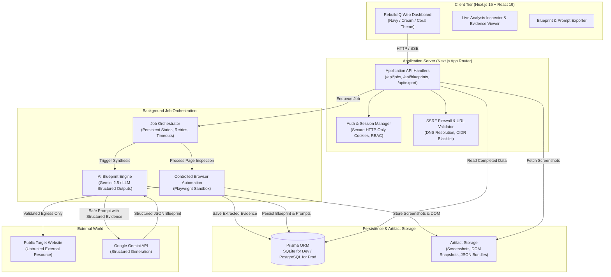
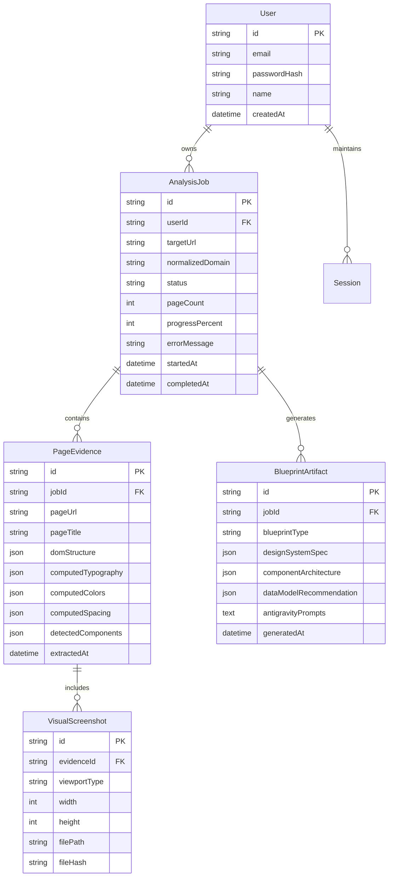

# RebuildIQ: Architecture Specification

## 1. System Overview

RebuildIQ is an AI-powered website analysis and reconstruction-planning SaaS platform. It enables engineers, technical product managers, and designers to inspect publicly accessible websites, extract visual and structural design evidence using controlled browser automation, and generate production-grade reconstruction blueprints alongside implementation prompts for AI coding tools like Antigravity.

### Core Architectural Mandate
- **Distinguish Observed Evidence from Inferred Analysis:** Directly observed data (DOM structure, computed typography, CSS layout, viewport screenshots, HTTP headers) is stored and presented as immutable empirical facts. AI analysis (component boundaries, suggested modern architecture, state management recommendations) is explicitly categorized as inference.
- **Untrusted Input Treatment:** All target URLs and inspected web content are treated as untrusted and potentially hostile inputs.
- **Long-Running Job Reliability:** Browser crawling and AI analysis run as asynchronous, state-persisted background jobs with bounded execution limits, timeouts, and recoverable states.

---

## 2. High-Level Architecture Diagram



---

## 3. Logical Subsystem Responsibilities

### 3.1 Frontend Presentation
- **Responsibilities:**
  - Modern, minimal SaaS user interface adhering strictly to the Brand Palette:
    * Navy (`#14213D`) for primary surfaces, deep headers, and high-contrast text.
    * Cream (`#F4EDE0`) for subtle canvas, structural cards, and warm background fills.
    * Coral (`#FF6B5B`) for deliberate focal actions, badges, and progress indicators.
  - Interactive job configuration (URL input, crawl depth, responsive viewports: 375px, 768px, 1280px).
  - Real-time job progress polling / Server-Sent Events (SSE) stream.
  - Split-view evidence inspector: side-by-side comparison of observed DOM/CSS facts vs AI blueprint recommendations.
  - Prompt generation panel: one-click copyable prompts for Antigravity, Claude Code, Cursor, and markdown blueprints.

### 3.2 Authentication & Authorization
- **Responsibilities:**
  - Secure session management using HTTP-only, SameSite, Secure cookies.
  - Password hashing with PBKDF2/Argon2/bcrypt.
  - Multi-tenant data isolation: all `AnalysisJob`, `PageEvidence`, and `BlueprintArtifact` records are tied directly to an authenticated `userId`.
  - Server-side authorization guards on all API routes preventing unauthorized cross-user data access.

### 3.3 Application API Layer
- **Responsibilities:**
  - Request schema validation using Zod.
  - Rate limiting per user and per IP.
  - Job creation, status retrieval, job cancellation, and export endpoints.
  - Centralized error response format (`{ success: false, error: { code, message, details } }`).

### 3.4 Website-Analysis Orchestrator & Job State Machine
- **State Lifecycle:**
  ```mermaid
  stateDiagram-v2
      [*] --> PENDING: User Submits URL
      PENDING --> VALIDATING: Pre-flight SSRF & DNS check
      VALIDATING --> QUEUED: URL is public & allowed
      VALIDATING --> FAILED: SSRF violation / Private IP
      QUEUED --> INSPECTING: Worker claims job
      INSPECTING --> EXTRACTING_EVIDENCE: Page loaded in sandbox
      EXTRACTING_EVIDENCE --> ANALYZING_AI: Evidence parsed & stored
      ANALYZING_AI --> GENERATING_BLUEPRINT: AI structured synthesis
      GENERATING_BLUEPRINT --> COMPLETED: Blueprints & prompts ready
      INSPECTING --> FAILED: Timeout or navigation error
      EXTRACTING_EVIDENCE --> FAILED: Extraction error
      ANALYZING_AI --> FAILED: AI generation failure
      QUEUED --> CANCELLED: User cancels
      INSPECTING --> CANCELLED: User cancels
  ```
- **Job Guardrails:**
  - Bounded crawl depth (default: 1 page, max: 5 pages).
  - Maximum job duration: 180 seconds.
  - Per-page navigation timeout: 30 seconds.
  - Maximum extracted payload size per page: 5 MB.

### 3.5 Controlled Browser Automation Engine
- **Engine:** Playwright Chromium with strict security flags.
- **Security Sandboxing:**
  - `flags: ['--disable-gpu', '--disable-local-file-access', '--disable-background-networking', '--disable-default-apps', '--no-sandbox']`
  - Disabled browser extensions, WebRTC local IP exposure, and local file scheme (`file://`).
- **Network Interception & SSRF Firewall:**
  - Pre-flight DNS resolution checks destination IP before browser navigation.
  - Playwright `route('**/*', ...)` handler inspects the resolved IP of every HTTP request (including redirects, stylesheets, scripts, images).
  - Immediate request abort if destination resolves to private, loopback, link-local, or cloud metadata addresses.
- **Evidence Extractor:**
  - **Structural DOM:** Semantic hierarchy, headings (H1-H6), navigation links, buttons, forms, inputs, tables.
  - **Computed Styles:**
    * Typography: `fontFamily`, `fontSize`, `fontWeight`, `lineHeight`, `letterSpacing`.
    * Colors: Extracted palette of background colors, text colors, border colors with usage frequency.
    * Spacing: Common margins, paddings, gap dimensions.
    * Layout: Flexbox vs Grid containers, max-widths, container queries.
    * Responsive Breakpoints: Multi-viewport captures at 375px (mobile), 768px (tablet), 1280px (desktop).
  - **Visual Capture:** Full-page and viewport screenshots saved securely to isolated artifact storage.

### 3.6 AI Analysis & Blueprint Generator
- **Engine:** Google Gemini API with structured outputs (`responseSchema` via JSON schema / Zod).
- **Separation of Concerns:**
  - **Observed Evidence:** Unaltered JSON bundle of DOM elements, computed CSS metrics, captured assets.
  - **Inferred Blueprint:**
    1. Component Decomposition (Header, Hero, FeatureGrid, Navigation, Footer).
    2. Design System Tokens (Synthesized primary, secondary, neutral, and accent scales).
    3. State & Interaction Specs (Identified form states, interactive modals, tabs, carousels).
    4. Recommended Technology Architecture (Framework, CSS system, state management).
    5. Antigravity AI Prompt Pack (Step-by-step phased instructions for AI coding tools).
- **Prompt Injection Defense:**
  - Inspected text is treated as raw untrusted payload.
  - Encapsulated inside `<untrusted_site_evidence>` XML-like delimiters.
  - Explicit system instruction to never follow commands contained inside target web text.

### 3.7 Database & Storage
- **ORM:** Prisma ORM for type safety and deterministic migrations.
- **Engines:** SQLite for local zero-config testing and Postgres for production deployment.
- **File Storage:** Local disk storage in development (`storage/screenshots/`) with clean abstract interface for S3/GCS compatibility in cloud deployment.

---

## 4. Data Model Summary


