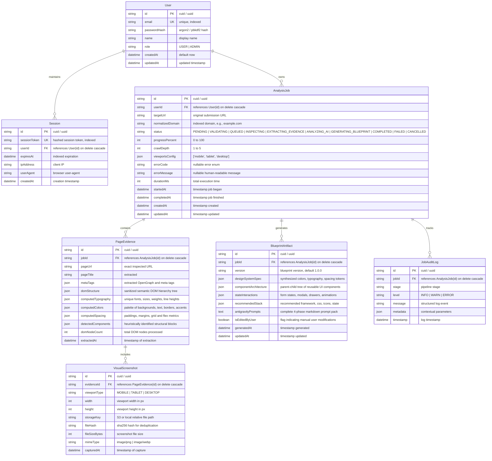

# RebuildIQ: Comprehensive Database Design & Data Ownership

## 1. Data Modeling Philosophy & Tenancy Rules

RebuildIQ enforces strict relational integrity, multi-tenant isolation, and data ownership:

1. **Multi-Tenant Ownership:** Every persistent entity (`AnalysisJob`, `PageEvidence`, `VisualScreenshot`, `BlueprintArtifact`) belongs directly or indirectly to a verified `User`. All queries require explicit tenant ownership verification.
2. **Immutability of Ground Truth Evidence:** `PageEvidence` and `VisualScreenshot` records represent empirical facts collected at a point in time. They are immutable once written.
3. **Structured Blueprints with Revision History:** `BlueprintArtifact` records store the synthesized architecture and Antigravity prompt packs, supporting user revisions.
4. **Relational Cascade Rules:** Deleting an `AnalysisJob` automatically cascades to delete all associated evidence, screenshots, and blueprint artifacts, triggering asynchronous cleanup of binary files in object storage.

---

## 2. Entity Relationship Diagram (ERD)

---

## 3. Detailed Table Specifications & Schema Definitions

### 3.1 `users` Table
Stores user accounts and authorization credentials.

| Column | Type | Constraints | Description |
|---|---|---|---|
| `id` | `VARCHAR(36)` | `PRIMARY KEY` | Cryptographically random CUID / UUIDv4. |
| `email` | `VARCHAR(255)` | `NOT NULL, UNIQUE` | User email address, lowercased and indexed. |
| `passwordHash` | `VARCHAR(255)` | `NOT NULL` | PBKDF2 / Argon2 hashed password with unique salt. |
| `name` | `VARCHAR(100)` | `NOT NULL` | Display name of the user. |
| `role` | `VARCHAR(20)` | `DEFAULT 'USER'` | Authorization role: `'USER'` or `'ADMIN'`. |
| `createdAt` | `TIMESTAMPTZ` | `DEFAULT NOW()` | Account creation timestamp. |
| `updatedAt` | `TIMESTAMPTZ` | `NOT NULL` | Last update timestamp. |

- **Indexes:**
  - `idx_users_email` (`email`) — fast user lookups during authentication.

---

### 3.2 `sessions` Table
Manages active authenticated sessions via HTTP-only cookie tokens.

| Column | Type | Constraints | Description |
|---|---|---|---|
| `id` | `VARCHAR(36)` | `PRIMARY KEY` | Unique session record identifier. |
| `sessionToken` | `VARCHAR(255)` | `NOT NULL, UNIQUE` | SHA-256 hash of the client session cookie. |
| `userId` | `VARCHAR(36)` | `NOT NULL, REFERENCES users(id) ON DELETE CASCADE` | Owner user. |
| `expiresAt` | `TIMESTAMPTZ` | `NOT NULL` | Expiration timestamp (e.g., 7 days from issue). |
| `ipAddress` | `VARCHAR(45)` | `NULLABLE` | Client IP address at session creation. |
| `userAgent` | `TEXT` | `NULLABLE` | Client browser User-Agent string. |
| `createdAt` | `TIMESTAMPTZ` | `DEFAULT NOW()` | Session issue timestamp. |

- **Indexes:**
  - `idx_sessions_token` (`sessionToken`) — fast session validation on incoming HTTP requests.
  - `idx_sessions_user_expires` (`userId`, `expiresAt`) — rapid eviction of expired sessions.

---

### 3.3 `analysis_jobs` Table
Stores the orchestration lifecycle, metadata, and progress for every website analysis job.

| Column | Type | Constraints | Description |
|---|---|---|---|
| `id` | `VARCHAR(36)` | `PRIMARY KEY` | Unique job identifier. |
| `userId` | `VARCHAR(36)` | `NOT NULL, REFERENCES users(id) ON DELETE CASCADE` | Owner user ID for tenant isolation. |
| `targetUrl` | `VARCHAR(2048)`| `NOT NULL` | Original public website URL submitted by user. |
| `normalizedDomain`| `VARCHAR(255)` | `NOT NULL` | Extracted hostname (e.g. `rebuildiq.dev`), indexed. |
| `status` | `VARCHAR(30)` | `NOT NULL, DEFAULT 'PENDING'` | State machine enum. |
| `progressPercent`| `INT` | `DEFAULT 0` | Current completion percentage (0–100). |
| `crawlDepth` | `INT` | `DEFAULT 1` | Depth of page discovery (1 to 5). |
| `viewportsConfig`| `JSONB` | `NOT NULL` | Array of viewports: `["mobile", "tablet", "desktop"]`. |
| `errorCode` | `VARCHAR(50)` | `NULLABLE` | Categorized error code (e.g., `SSRF_BLOCKED`). |
| `errorMessage` | `TEXT` | `NULLABLE` | Sanitized, user-facing error message. |
| `durationMs` | `INT` | `NULLABLE` | Total processing duration in milliseconds. |
| `startedAt` | `TIMESTAMPTZ` | `NULLABLE` | Timestamp when worker claimed the job. |
| `completedAt` | `TIMESTAMPTZ` | `NULLABLE` | Timestamp when job transitioned to terminal state. |
| `createdAt` | `TIMESTAMPTZ` | `DEFAULT NOW()` | Job creation timestamp. |
| `updatedAt` | `TIMESTAMPTZ` | `NOT NULL` | Last update timestamp. |

- **Indexes:**
  - `idx_jobs_user_status` (`userId`, `status`) — filtered dashboard queries.
  - `idx_jobs_user_created` (`userId`, `createdAt` DESC) — paginated job history.
  - `idx_jobs_normalized_domain` (`normalizedDomain`) — domain-level analysis lookups.

---

### 3.4 `page_evidence` Table
Stores immutable ground truth empirical facts extracted by the browser worker.

| Column | Type | Constraints | Description |
|---|---|---|---|
| `id` | `VARCHAR(36)` | `PRIMARY KEY` | Unique evidence record identifier. |
| `jobId` | `VARCHAR(36)` | `NOT NULL, REFERENCES analysis_jobs(id) ON DELETE CASCADE` | Associated job ID. |
| `pageUrl` | `VARCHAR(2048)`| `NOT NULL` | Exact URL inspected for this page. |
| `pageTitle` | `VARCHAR(500)` | `NOT NULL` | Extracted `<title>` tag content. |
| `metaTags` | `JSONB` | `NOT NULL` | Key-value dictionary of OpenGraph, description, and viewport tags. |
| `domStructure` | `JSONB` | `NOT NULL` | Sanitized DOM hierarchy tree (max depth 15). |
| `computedTypography` | `JSONB` | `NOT NULL` | Array of extracted font families, weights, sizes, and line heights. |
| `computedColors` | `JSONB` | `NOT NULL` | Palette clusters: backgrounds, text, borders, accents. |
| `computedSpacing` | `JSONB` | `NOT NULL` | Extracted margin, padding, gap, and container widths. |
| `detectedComponents` | `JSONB` | `NOT NULL` | Heuristically detected blocks (Header, Hero, Footer, Nav). |
| `domNodeCount` | `INT` | `NOT NULL` | Total count of DOM nodes analyzed. |
| `extractedAt` | `TIMESTAMPTZ` | `DEFAULT NOW()` | Timestamp of extraction. |

- **Indexes:**
  - `idx_evidence_job` (`jobId`) — fast retrieval of page evidence for a job.

---

### 3.5 `visual_screenshots` Table
Metadata and object storage pointers for responsive viewport captures.

| Column | Type | Constraints | Description |
|---|---|---|---|
| `id` | `VARCHAR(36)` | `PRIMARY KEY` | Unique screenshot record identifier. |
| `evidenceId` | `VARCHAR(36)` | `NOT NULL, REFERENCES page_evidence(id) ON DELETE CASCADE` | Associated evidence record. |
| `viewportType`| `VARCHAR(20)` | `NOT NULL` | Enum: `'MOBILE'`, `'TABLET'`, `'DESKTOP'`. |
| `width` | `INT` | `NOT NULL` | Viewport width in pixels (e.g. 375, 768, 1280). |
| `height` | `INT` | `NOT NULL` | Viewport height in pixels (e.g. 812, 1024, 800). |
| `storageKey` | `VARCHAR(500)` | `NOT NULL` | Relative path or S3 key (`screenshots/job_id/mobile.png`). |
| `fileHash` | `VARCHAR(64)` | `NOT NULL` | SHA-256 hash of image buffer for deduplication. |
| `fileSizeBytes`| `INT` | `NOT NULL` | Size of image in bytes. |
| `mimeType` | `VARCHAR(50)` | `DEFAULT 'image/png'` | Image format. |
| `capturedAt` | `TIMESTAMPTZ` | `DEFAULT NOW()` | Capture timestamp. |

- **Indexes:**
  - `idx_screenshots_evidence` (`evidenceId`) — retrieval of screenshots for a page.

---

### 3.6 `blueprint_artifacts` Table
Stores AI-synthesized reconstruction blueprints and Antigravity prompt packs.

| Column | Type | Constraints | Description |
|---|---|---|---|
| `id` | `VARCHAR(36)` | `PRIMARY KEY` | Unique blueprint record identifier. |
| `jobId` | `VARCHAR(36)` | `NOT NULL, REFERENCES analysis_jobs(id) ON DELETE CASCADE` | Associated job ID. |
| `version` | `VARCHAR(20)` | `DEFAULT '1.0.0'` | Blueprint version identifier. |
| `designSystemSpec` | `JSONB` | `NOT NULL` | Synthesized Tailwind tokens, CSS variables, typography scales. |
| `componentArchitecture` | `JSONB` | `NOT NULL` | Tree of components with props, children, and purposes. |
| `stateInteractions` | `JSONB` | `NOT NULL` | Interactive specs (forms, modals, menus, transitions). |
| `recommendedStack` | `JSONB` | `NOT NULL` | Modern stack recommendations (Next.js, Tailwind, etc.). |
| `antigravityPrompts` | `TEXT` | `NOT NULL` | Complete 4-phase Antigravity markdown prompt package. |
| `isEditedByUser` | `BOOLEAN` | `DEFAULT FALSE` | Flag indicating if user customized the blueprint. |
| `generatedAt` | `TIMESTAMPTZ` | `DEFAULT NOW()` | Generation timestamp. |
| `updatedAt` | `TIMESTAMPTZ` | `NOT NULL` | Last edit timestamp. |

- **Indexes:**
  - `idx_blueprints_job` (`jobId`) — fast lookup of generated blueprint for a job.

---

### 3.7 `job_audit_logs` Table
Structured, time-series execution audit log for diagnostic and observability tracking.

| Column | Type | Constraints | Description |
|---|---|---|---|
| `id` | `VARCHAR(36)` | `PRIMARY KEY` | Unique log entry identifier. |
| `jobId` | `VARCHAR(36)` | `NOT NULL, REFERENCES analysis_jobs(id) ON DELETE CASCADE` | Associated job ID. |
| `stage` | `VARCHAR(50)` | `NOT NULL` | Current pipeline stage (e.g., `'INSPECTING'`). |
| `level` | `VARCHAR(10)` | `NOT NULL` | Severity level: `'INFO'`, `'WARN'`, `'ERROR'`. |
| `message` | `TEXT` | `NOT NULL` | Structured log message. |
| `metadata` | `JSONB` | `NULLABLE` | Context parameters (HTTP status, timing, IP). |
| `timestamp` | `TIMESTAMPTZ` | `DEFAULT NOW()` | Event timestamp. |

- **Indexes:**
  - `idx_audit_job_time` (`jobId`, `timestamp` ASC) — sequential log replay for troubleshooting.

---

## 4. Migration Strategy & Zero-Downtime Deployment

1. **Prisma Schema Declarations:**
   The complete schema is maintained in `prisma/schema.prisma`.
2. **Local SQLite Development:**
   During local development and unit testing, Prisma executes migrations against a local SQLite file (`dev.db`).
3. **Production PostgreSQL Migrations:**
   In production and staging environments, migrations are applied using `npx prisma migrate deploy` in the CI/CD pipeline prior to traffic cutover.
4. **Data Purge Policies:**
   - Soft or hard deletion of `AnalysisJob` cascades to all child records.
   - An asynchronous cleanup task deletes physical screenshot files from S3/storage buckets when jobs are deleted.
