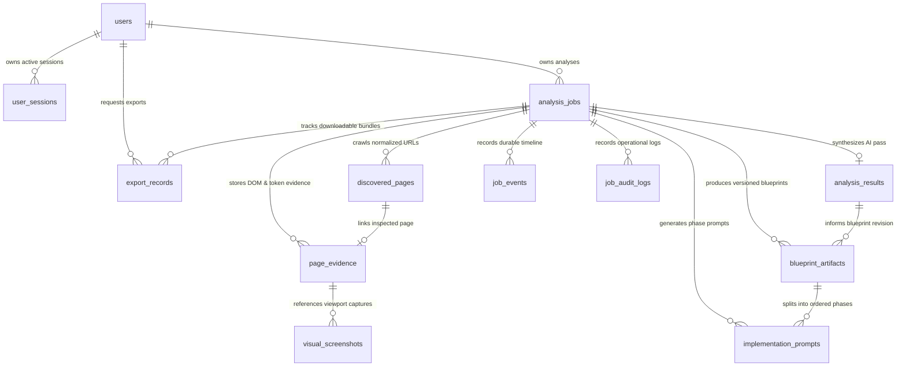
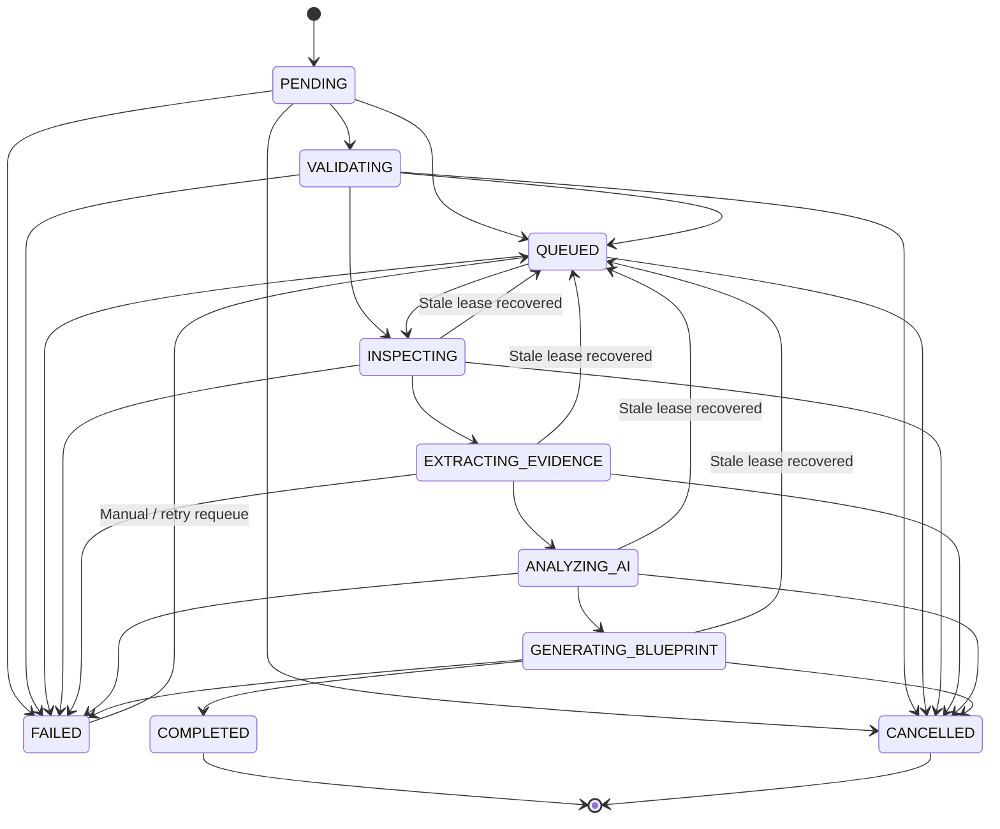

# RebuildIQ: Production Database Design, Data Dictionary & Migration Runbook

**Architecture Version:** 2.0 (Complete Domain Model)  
**Primary Production Engine:** PostgreSQL 15+ (Supabase Managed PostgreSQL + Supabase Storage)  
**Local & Disposable Validation Engine:** SQLite via Prisma ORM v5 (`prisma/schema.prisma`)  
**Typed Data Access:** `PrismaAnalysisRepository`, `SupabaseAnalysisRepository`, `lib/supabase/database.types.ts`, `lib/db/state-machine.ts`

---

## 1. Schema Parity & Implementation Layout

RebuildIQ maintains strict parity between its Supabase PostgreSQL production schema and its Prisma ORM models for local development and isolated disposable database validation:

| Artifact | Purpose | Environment |
|---|---|---|
| `supabase/migrations/20261126000001_rebuildiq_core.sql` | Core 7 tables, extensions (`pgcrypto`), triggers, and storage policies | Supabase PostgreSQL (Applied live) |
| `supabase/migrations/20261126000002_production_auth_hardening.sql` | Least-privilege grants, active-account RLS, role guard triggers, `private.account_deletion_ledger`, retention cleanup | Supabase PostgreSQL (Applied live) |
| `supabase/migrations/20261126000003_complete_domain_data_model.sql` | Durable job state machine, `SKIP LOCKED` claim & stale crash recovery functions, idempotency indexes, `discovered_pages`, `analysis_results`, `implementation_prompts`, `export_records`, `job_events`, object-storage CHECK constraints & RLS | Supabase PostgreSQL (Applied live) |
| `prisma/schema.prisma` + `prisma/migrations/*` | Local/disposable SQLite migration history (`20261124113424_init_phase2_schema` + `20261126175232_complete_domain_data_model`) with trigger parity | Local SQLite & Disposable Test DBs |
| `prisma/schema.postgresql.prisma` | Declarative Prisma reference schema aligned 1:1 with Supabase PostgreSQL types (`@db.Uuid`, `@db.Timestamptz(6)`, enums) | Reference / Standalone PostgreSQL |
| `lib/db/` | `state-machine.ts`, `types.ts`, `repositories/prisma-analysis-repository.ts`, `repositories/supabase-analysis-repository.ts` | Server Runtime & Workers |

---

## 2. Entity Relationship Diagram



---

## 3. Complete Data Dictionary (All 12 Domain Entities)

> Note: Column names below show Supabase PostgreSQL column names (`snake_case`, defined in `lib/supabase/database.types.ts`); Prisma TypeScript fields map automatically to `camelCase`, and Supabase's `user_sessions` maps to Prisma model `Session` (`sessions`).

### 3.1 `users` (Authenticated Account Profile)
Anchored to Supabase Auth `auth.users(id)` (or Prisma credentials for local SQLite test fixtures). No plaintext secrets or OAuth access tokens are stored in application tables.

| Column | Type | Constraints / Default | Purpose |
|---|---|---|---|
| `id` | `uuid` / `text` | `PRIMARY KEY` | Matches verified auth provider UID (`auth.uid()`) |
| `email` | `text` | `UNIQUE NOT NULL` | Normalized account email |
| `name` | `text` | `NOT NULL` | Display name shown in workspace chrome |
| `role` | `text` | `NOT NULL DEFAULT 'USER'` | RBAC role; column-grant & trigger protected against self-escalation |
| `default_prompt_target` | `text` | `NOT NULL DEFAULT 'antigravity'` | Preferred prompt generator target (`antigravity`, `cursor`, `claude`) |
| `deleted_at` | `timestamptz` | `NULL` | Soft-deletion timestamp blocking RLS access immediately |
| `deletion_scheduled_at` | `timestamptz` | `NULL` | Grace-window target for permanent purge (`deletion_reason` recorded alongside) |
| `deletion_reason` | `text` | `NULL` | Optional audit reason supplied on account deletion |
| `created_at`, `updated_at` | `timestamptz` | `NOT NULL DEFAULT now()` | Lifecycle audit timestamps |

### 3.2 `user_sessions` (Prisma: `sessions`)
Tracks server-validated login sessions for revocation and Settings session management.

| Column | Type | Constraints / Default | Purpose |
|---|---|---|---|
| `id` | `uuid` / `text` | `PRIMARY KEY` | Session audit record identifier |
| `user_id` | `uuid` / `text` | `NOT NULL REFERENCES users(id) ON DELETE CASCADE` | Owning user |
| `auth_session_id` | `text` | `NULL` | Correlated Supabase JWT `session_id` claim |
| `auth_method` | `text` | `NOT NULL DEFAULT 'password'` | Sign-in flow identifier (`password`, `recovery`, etc.) |
| `ip_address` | `text` | `NULL` | Client address captured at login |
| `user_agent` | `text` | `NULL` | Browser User-Agent summary for session UI |
| `expires_at` | `timestamptz` | `NULL` | Session expiration horizon |
| `last_active_at` | `timestamptz` | `NOT NULL DEFAULT now()` | Latest authenticated activity |
| `logged_in_at` | `timestamptz` | `NOT NULL DEFAULT now()` | Session creation time |
| `revoked_at` | `timestamptz` | `NULL` | Non-null once revoked from Settings or logout |

### 3.3 `analysis_jobs` (Durable Job Root)
Primary tenant-owned aggregate orchestrating crawl, extraction, AI inference, blueprint synthesis, worker lease locking, idempotency, and retention.

| Column | Type | Constraints / Default | Purpose |
|---|---|---|---|
| `id` | `uuid` / `text` | `PRIMARY KEY DEFAULT gen_random_uuid()` | Unique job ID |
| `user_id` | `uuid` / `text` | `NOT NULL REFERENCES users(id) ON DELETE CASCADE` | Mandatory owner (`auth.uid()`) |
| `target_url` | `text` | `NOT NULL` | Submitted SSRF-validated target URL |
| `normalized_domain` | `text` | `NOT NULL` | Canonical root host without `www.` |
| `status` | `text` | `NOT NULL DEFAULT 'QUEUED'` | Enforced durable job state |
| `progress_percent` | `integer` | `NOT NULL DEFAULT 0` | Monotonic UI pipeline indicator (`0`–`100`) |
| `crawl_depth` | `integer` | `NOT NULL DEFAULT 1` | Requested crawl breadth (`1`–`5`) |
| `viewports_config` | `jsonb` | `NOT NULL DEFAULT '["desktop","mobile"]'` | Target capture viewports |
| `idempotency_key` | `text` | `NULL`, unique partial `(user_id, idempotency_key)` | Prevents duplicate job creation on retries |
| `worker_id` | `text` | `NULL` | Active worker holding lease |
| `lease_expires_at` | `timestamptz` | `NULL` | Lease expiry deadline for crash recovery |
| `heartbeat_at` | `timestamptz` | `NULL` | Latest worker heartbeat timestamp |
| `attempt_count` | `integer` | `NOT NULL DEFAULT 0` (`CHECK 0 <= attempt_count <= max_attempts`) | Execution attempts consumed |
| `max_attempts` | `integer` | `NOT NULL DEFAULT 3` | Maximum automatic retry budget |
| `cancelled_at` | `timestamptz` | `NULL` | Explicit cancellation timestamp |
| `cancellation_reason` | `text` | `NULL` | Reason provided on cancellation |
| `expires_at` | `timestamptz` | `NULL` (application default +90d) | Automated data-retention deadline |
| `error_code`, `error_message` | `text` | `NULL` | Structured failure diagnostics |
| `duration_ms` | `integer` | `NULL` | End-to-end pipeline execution time |
| `created_at`, `started_at`, `completed_at`, `updated_at` | `timestamptz` | `created_at/updated_at NOT NULL` | Lifecycle timestamps |

### 3.4 `discovered_pages`
Normalized URL frontier crawled for an `analysis_jobs` execution.

| Column | Type | Constraints / Default | Purpose |
|---|---|---|---|
| `id` | `uuid` / `text` | `PRIMARY KEY` | Discovered page ID |
| `job_id` | `uuid` / `text` | `NOT NULL REFERENCES analysis_jobs(id) ON DELETE CASCADE` | Parent job |
| `url` | `text` | `NOT NULL` | Raw discovered URL |
| `normalized_url` | `text` | `NOT NULL`, `UNIQUE(job_id, normalized_url)` | Canonicalized URL preventing duplicate crawl |
| `depth` | `integer` | `NOT NULL DEFAULT 0` (`CHECK 0..5`) | Link distance from entry URL |
| `http_status` | `integer` | `NULL` | HTTP status returned during fetch |
| `status` | `text` | `NOT NULL DEFAULT 'DISCOVERED'` | `DISCOVERED`, `QUEUED`, `INSPECTING`, `COMPLETED`, `FAILED`, `SKIPPED` |
| `is_entry_page` | `boolean` | `NOT NULL DEFAULT false` | Flags initial submission page |
| `error_code` | `text` | `NULL` | Optional fetch/SSRF skip reason |
| `discovered_at`, `inspected_at` | `timestamptz` | `discovered_at NOT NULL` | Crawl/inspection timestamps |

### 3.5 `page_evidence`
Observed ground-truth DOM hierarchy, CSS custom properties, typography, palette, spacing metrics, and structural metadata captured from browser inspection.

| Column | Type | Constraints / Default | Purpose |
|---|---|---|---|
| `id` | `uuid` / `text` | `PRIMARY KEY` | Evidence record ID |
| `job_id` | `uuid` / `text` | `NOT NULL REFERENCES analysis_jobs(id) ON DELETE CASCADE` | Parent job |
| `discovered_page_id` | `uuid` / `text` | `NULL REFERENCES discovered_pages(id) ON DELETE SET NULL`, partial unique when non-null | Normalized page link |
| `page_url` | `text` | `NOT NULL`, `UNIQUE(job_id, page_url)` | Inspected page URL |
| `page_title` | `text` | `NOT NULL` | Extracted `<title>` |
| `meta_tags`, `dom_structure`, `computed_typography`, `computed_colors`, `computed_spacing`, `detected_components` | `jsonb` / `text` | `NOT NULL` | Observed design & layout telemetry |
| `dom_node_count` | `integer` | `NOT NULL` | Inspected DOM size |
| `dom_snapshot_storage_key` | `text` | `NULL`, `CHECK (NOT LIKE 'data:%')` | Optional object storage key for large raw DOM snapshots |
| `extracted_at` | `timestamptz` | `NOT NULL DEFAULT now()` | Capture time |

### 3.6 `visual_screenshots`
Metadata index pointing exclusively to object storage keys in bucket `rebuildiq-artifacts`.

| Column | Type | Constraints / Default | Purpose |
|---|---|---|---|
| `id` | `uuid` / `text` | `PRIMARY KEY` | Screenshot metadata ID |
| `evidence_id` | `uuid` / `text` | `NOT NULL REFERENCES page_evidence(id) ON DELETE CASCADE` | Parent page evidence |
| `viewport_type` | `text` | `NOT NULL`, `UNIQUE(evidence_id, viewport_type)` | `MOBILE`, `TABLET`, or `DESKTOP` |
| `width`, `height` | `integer` | `NOT NULL` | Rendered viewport dimensions |
| `storage_bucket` | `text` | `NOT NULL DEFAULT 'rebuildiq-artifacts'` | Target storage bucket |
| `storage_key` | `text` | `NOT NULL`, `CHECK (NOT LIKE 'data:%' AND length > 0)` | `<userId>/<jobId>/<filename>` object key (no inline blobs) |
| `file_hash`, `file_size_bytes`, `mime_type` | `text`/`integer` | `NOT NULL` | Integrity checksum & size |
| `captured_at` | `timestamptz` | `NOT NULL DEFAULT now()` | Capture timestamp |

### 3.7 `analysis_results`
Structured AI synthesis summarizing architectural patterns, design-token consolidation, confidence scores, and evidence coverage prior to blueprint rendering.

| Column | Type | Constraints / Default | Purpose |
|---|---|---|---|
| `id` | `uuid` / `text` | `PRIMARY KEY` | Result record ID |
| `job_id` | `uuid` / `text` | `NOT NULL UNIQUE REFERENCES analysis_jobs(id) ON DELETE CASCADE` | 1:1 with analysis job |
| `provider` | `text` | `NOT NULL` (`CHECK IN ('gemini','mock')`) | Synthesis provider |
| `model_name` | `text` | `NOT NULL` | Exact model ID used |
| `architecture_summary` | `text` | `NOT NULL` | Executive architectural assessment |
| `detected_patterns`, `design_token_summary`, `evidence_coverage` | `jsonb` | `NOT NULL` | Structured pattern & coverage specs |
| `confidence_score` | `numeric(4,3)` | `NULL` (`CHECK 0 <= x <= 1`) | Model confidence metric |
| `raw_artifact_storage_key` | `text` | `NULL`, `CHECK (NOT LIKE 'data:%')` | Optional object storage key for large model trace payloads |
| `created_at`, `updated_at` | `timestamptz` | `NOT NULL DEFAULT now()` | Lifecycle timestamps |

### 3.8 `blueprint_artifacts`
Versioned website reconstruction architecture generated from observed evidence and AI synthesis.

| Column | Type | Constraints / Default | Purpose |
|---|---|---|---|
| `id` | `uuid` / `text` | `PRIMARY KEY` | Blueprint ID |
| `job_id` | `uuid` / `text` | `NOT NULL REFERENCES analysis_jobs(id) ON DELETE CASCADE` | Parent job |
| `analysis_result_id` | `uuid` / `text` | `NULL REFERENCES analysis_results(id) ON DELETE SET NULL` | Upstream synthesis record |
| `version` | `text` | `NOT NULL DEFAULT '1.0'`, `UNIQUE(job_id, version)` | Semantic revision |
| `design_system_spec`, `component_architecture`, `state_interactions`, `recommended_stack` | `jsonb` | `NOT NULL` | Structured architecture JSON specifications |
| `antigravity_prompts` | `text` | `NOT NULL DEFAULT ''` | Combined prompt fallback markdown |
| `blueprint_storage_key` | `text` | `NULL`, `CHECK (NOT LIKE 'data:%')` | Optional externalized large JSON/MD artifact key |
| `is_edited_by_user` | `boolean` | `NOT NULL DEFAULT false` | Flags customized revisions |
| `generated_at`, `updated_at` | `timestamptz` | `NOT NULL DEFAULT now()` | Revision timestamps |

### 3.9 `implementation_prompts`
Normalized phased build instructions keyed per blueprint, target AI coding tool, and ordered phase number.

| Column | Type | Constraints / Default | Purpose |
|---|---|---|---|
| `id` | `uuid` / `text` | `PRIMARY KEY` | Prompt record ID |
| `blueprint_id` | `uuid` / `text` | `NOT NULL REFERENCES blueprint_artifacts(id) ON DELETE CASCADE` | Owning blueprint |
| `job_id` | `uuid` / `text` | `NOT NULL REFERENCES analysis_jobs(id) ON DELETE CASCADE` | Parent job for RLS scoping |
| `phase_number` | `integer` | `NOT NULL` (`CHECK 1..10`) | Sequence step |
| `target_tool` | `text` | `NOT NULL DEFAULT 'antigravity'` (`antigravity`, `cursor`, `claude`, `generic`) | Target coding assistant |
| `title`, `objective`, `prompt_markdown` | `text` | `NOT NULL` | Phase prompt metadata & content |
| `prompt_hash` | `text` | `NOT NULL` | SHA-256 content digest (`UNIQUE(blueprint_id, target_tool, phase_number)`) |
| `is_edited_by_user` | `boolean` | `NOT NULL DEFAULT false` | Tracks manual user edits |
| `version` | `integer` | `NOT NULL DEFAULT 1` | Revision counter |
| `created_at`, `updated_at` | `timestamptz` | `NOT NULL DEFAULT now()` | Timestamps |

### 3.10 `export_records`
Tracks downloadable reconstruction packs (`.md`, `.json`, Tailwind `.ts`, evidence JSON, server `.zip`) with storage keys and short-lived retention windows.

| Column | Type | Constraints / Default | Purpose |
|---|---|---|---|
| `id` | `uuid` / `text` | `PRIMARY KEY` | Export record ID |
| `job_id` | `uuid` / `text` | `NOT NULL REFERENCES analysis_jobs(id) ON DELETE CASCADE` | Source job |
| `user_id` | `uuid` / `text` | `NOT NULL REFERENCES users(id) ON DELETE CASCADE` | Direct owner (`auth.uid()`) |
| `format` | `text` | `NOT NULL` | `prompts-md`, `blueprint-md`, `blueprint-json`, `tailwind-ts`, `evidence-json`, `zip` |
| `storage_key` | `text` | `NULL`, `CHECK (NOT LIKE 'data:%')` | Storage key for persisted bundle |
| `file_hash`, `file_size_bytes` | `text`/`integer` | `NULL` | Checksum & payload size |
| `status` | `text` | `NOT NULL DEFAULT 'READY'` | `PENDING`, `READY`, `FAILED`, `EXPIRED` |
| `expires_at` | `timestamptz` | `NOT NULL DEFAULT now() + 7 days` | Export storage/record retention TTL |
| `downloaded_at`, `created_at` | `timestamptz` | `created_at NOT NULL` | Delivery audit timestamps |

### 3.11 `job_events`
Append-only operational state-transition and worker lifecycle journal (`GRANT SELECT, INSERT` only for authenticated owners; no client `UPDATE`/`DELETE`).

| Column | Type | Constraints / Default | Purpose |
|---|---|---|---|
| `id` | `uuid` / `text` | `PRIMARY KEY` | Event ID |
| `job_id` | `uuid` / `text` | `NOT NULL REFERENCES analysis_jobs(id) ON DELETE CASCADE` | Parent job |
| `event_type` | `text` | `NOT NULL` | `JOB_CREATED`, `STATUS_TRANSITION`, `WORKER_CLAIMED`, `HEARTBEAT`, `STALE_RECOVERED`, `PAGE_DISCOVERED`, `EVIDENCE_CAPTURED`, `AI_COMPLETED`, `BLUEPRINT_GENERATED`, `EXPORT_CREATED`, `JOB_CANCELLED`, `JOB_FAILED` |
| `from_status`, `to_status`, `worker_id` | `text` | `NULL` | Transition & worker context |
| `attempt_number` | `integer` | `NOT NULL DEFAULT 0` | Worker attempt counter |
| `message` | `text` | `NOT NULL` | Human-readable timeline message |
| `metadata` | `jsonb` | `NULL` | Structured diagnostic context |
| `idempotency_key` | `text` | `NULL`, partial unique `(job_id, idempotency_key)` | Prevents duplicate event replay |
| `created_at` | `timestamptz` | `NOT NULL DEFAULT now()` | Event timestamp |

### 3.12 `job_audit_logs`
Human-oriented inspection log stream maintained alongside `job_events` for stage-level UI progress rendering.

| Column | Type | Constraints / Default | Purpose |
|---|---|---|---|
| `id` | `uuid` / `text` | `PRIMARY KEY` | Log ID |
| `job_id` | `uuid` / `text` | `NOT NULL REFERENCES analysis_jobs(id) ON DELETE CASCADE` | Parent job |
| `stage`, `level`, `message` | `text` | `NOT NULL` | Stage name, severity (`INFO`/`WARN`/`ERROR`), message |
| `metadata` | `jsonb` | `NULL` | Optional structured metadata |
| `timestamp` | `timestamptz` | `NOT NULL DEFAULT now()` | Log creation time |

---

## 4. Durable Job State Machine & Crash Recovery

### 4.1 Valid Transitions (`lib/db/state-machine.ts` & DB Triggers)

Both application services (`assertValidJobTransition`) and database triggers (`private.enforce_analysis_job_transition()` in PostgreSQL; `trg_analysis_jobs_status_transition` in SQLite) reject invalid state jumps (`InvalidStateTransitionError`, HTTP `409`):



### 4.2 Worker Lease Claiming & Stale Crash Recovery
1. **Single-Winner Lease Claim**:
   - PostgreSQL uses `private.claim_next_analysis_job(p_worker_id, p_lease_seconds)` with `FOR UPDATE OF j SKIP LOCKED`, selecting only `QUEUED` jobs where `attempt_count < max_attempts` and owner `users.deleted_at IS NULL`, incrementing `attempt_count`, setting `status = 'INSPECTING'`, `worker_id`, `heartbeat_at`, and `lease_expires_at`, and logging `WORKER_CLAIMED`.
   - Application repositories (`PrismaAnalysisRepository` via interactive `$transaction`, `SupabaseAnalysisRepository` via optimistic compare-and-set on `status = 'QUEUED'`) mirror this exact guarantee.
2. **Heartbeat Extension**: Long-running browser or AI passes call `heartbeatJob(jobId, workerId, extendLeaseMs)` to extend `lease_expires_at`.
3. **Crash / Deployment Interruption Recovery**:
   - A periodic supervisor invokes `private.recover_stale_analysis_jobs()` (PostgreSQL) or `recoverStaleJobs()` (repositories).
   - Any job in active phases (`INSPECTING`, `EXTRACTING_EVIDENCE`, `ANALYZING_AI`, `GENERATING_BLUEPRINT`) whose `lease_expires_at < now()`:
     - If `attempt_count < max_attempts`, resets `status = 'QUEUED'`, clears `worker_id` & `lease_expires_at`, and logs `STALE_RECOVERED`.
     - If `attempt_count >= max_attempts`, transitions to `FAILED` (`error_code = 'WORKER_CRASH_MAX_RETRIES'`, clears `worker_id`/`lease_expires_at`, sets `completed_at`) and logs `JOB_FAILED`.

---

## 5. Idempotency & Object Storage Rules

### 5.1 Idempotency Controls
| Operation | Uniqueness Key / Guard | Duplicate Behavior |
|---|---|---|
| Job Submission (`createJob`) | `(user_id, idempotency_key)` where non-null | Returns `{ job: existing, deduplicated: true }` cleanly even on concurrent `P2002`/`23505` race |
| Discovered URLs (`upsertDiscoveredPage`) | `(job_id, normalized_url)` via `normalizePageUrl` (lowercased scheme/host, stripped `#hash`, default ports & trailing slashes removed) | Upserts existing discovered page metadata without duplicate crawl rows |
| Evidence Capture | `(job_id, page_url)` and partial unique `(discovered_page_id)` | Idempotent overwrite/refresh on retry |
| Screenshots | `(evidence_id, viewport_type)` | One screenshot metadata row per viewport (`MOBILE`, `TABLET`, `DESKTOP`) |
| AI Results & Blueprints | `analysis_results(job_id)` and `blueprint_artifacts(job_id, version)` | Upserts cleanly across retried synthesis attempts |
| Prompts | `implementation_prompts(blueprint_id, target_tool, phase_number)` | Upserts with `prompt_hash` (`sha256Hex`) |
| Operational Events | `job_events(job_id, idempotency_key)` where non-null | Ignores duplicate event emission cleanly |

### 5.2 Object-Storage-Only Media Discipline
- Raw PNG/WebP screenshots, optional full DOM dumps, raw AI JSON traces, and downloadable archive bundles live in the private **Supabase Storage** bucket `rebuildiq-artifacts` under `<userId>/<jobId>/<sanitized-filename>` (`buildUserArtifactKey`).
- Inline base64 `data:` URIs and empty keys are rejected in **three layers**:
  1. `assertSafeObjectStorageKey()` in `lib/db/state-machine.ts`
  2. PostgreSQL `CHECK` constraints (`NOT LIKE 'data:%'`) in `20261126000003_complete_domain_data_model.sql`
  3. SQLite `BEFORE INSERT` / `BEFORE UPDATE` triggers (`trg_visual_screenshots_no_inline_blob_*`, `trg_export_records_no_inline_blob_insert`) in `20261126175232_complete_domain_data_model/migration.sql`

---

## 6. Ownership, Retention & Deletion Policy

1. **Multi-Tenant Isolation (`NotFoundError` 404 + RLS)**:
   - Every user-facing repository query filters strictly by verified server `userId` (`eq('user_id', userId)` / `where: { id: jobId, userId }`) and throws `NotFoundError` (`404`) rather than revealing resource existence across tenants.
   - PostgreSQL RLS policies (`TO authenticated`, cached `(SELECT auth.uid())`, `u.deleted_at IS NULL`) enforce identical tenant isolation even for direct Supabase queries, while privileged worker/maintenance functions live in the unexposed `private` schema with `REVOKE ALL ... FROM PUBLIC, anon, authenticated`.
2. **Retention Horizons & Cascade Cleanup**:
   - `export_records.expires_at`: defaults to **7 days** after creation.
   - `analysis_jobs.expires_at`: defaults to **90 days** after creation (configurable per plan/input).
   - Deleting a job (`deleteJobForUser`) or running retention sweeps (`purgeExpiredRetentionData` / `private.purge_expired_retention_data()`) gathers all child object storage keys (`dom_snapshot_storage_key`, `visual_screenshots.storage_key`, `raw_artifact_storage_key`, `blueprint_storage_key`, `export_records.storage_key`) so the caller deletes storage objects immediately alongside relational `ON DELETE CASCADE` removal.
   - Account soft-deletion sets `users.deleted_at`, immediately hiding all rows under RLS and excluding the user's queued jobs from worker claiming before delayed purge completes.

---

## 7. Migration & Rollback Procedures

### 7.1 Forward Application
- **Local / Disposable SQLite (Prisma):**
  ```bash
  npx prisma migrate deploy
  npx prisma generate
  ```
- **Supabase PostgreSQL:**
  Run migrations sequentially in Supabase SQL Editor (or Supabase CLI):
  1. `supabase/migrations/20261126000001_rebuildiq_core.sql` (applied on live Supabase)
  2. `supabase/migrations/20261126000002_production_auth_hardening.sql` (applied on live Supabase)
  3. `supabase/migrations/20261126000003_complete_domain_data_model.sql` (applied on live Supabase and verified via live RLS/trigger/function inspection + Supabase Security & Performance Advisors; validated behaviorally via Prisma SQLite parity in `tests/disposable-db.test.ts` and static assertions in `tests/supabase.test.ts`).

### 7.2 Rollback Considerations
Because `20261126000003` / `20261126175232` introduce normalized tables (`discovered_pages`, `analysis_results`, `implementation_prompts`, `export_records`, `job_events`) and additive columns (`analysis_jobs.idempotency_key`, `worker_id`, etc.):
1. **Zero-Downtime Code Rollback First:** Application read paths (`loadAnalysisDetailOrNotFound`, `SupabaseAnalysisRepository`) degrade cleanly to baseline `000001`/`000002` tables if `000003` tables are empty or absent.
2. **Database Backup Before Destructive Rollback:** Never execute `DROP TABLE` against populated `export_records` or `discovered_pages` without taking a snapshot and cleaning orphaned `rebuildiq-artifacts` objects if storage keys are dropped.
3. **Manual Additive Rollback SQL (PostgreSQL):**
   ```sql
   DROP TRIGGER IF EXISTS trg_analysis_jobs_transition ON public.analysis_jobs;
   DROP FUNCTION IF EXISTS private.enforce_analysis_job_transition();
   DROP FUNCTION IF EXISTS private.claim_next_analysis_job(text, integer);
   DROP FUNCTION IF EXISTS private.recover_stale_analysis_jobs();
   DROP FUNCTION IF EXISTS private.purge_expired_retention_data();
   DROP TABLE IF EXISTS public.job_events CASCADE;
   DROP TABLE IF EXISTS public.export_records CASCADE;
   DROP TABLE IF EXISTS public.implementation_prompts CASCADE;
   DROP TABLE IF EXISTS public.analysis_results CASCADE;
   DROP TABLE IF EXISTS public.discovered_pages CASCADE;
   ALTER TABLE public.blueprint_artifacts
     DROP COLUMN IF EXISTS analysis_result_id,
     DROP COLUMN IF EXISTS blueprint_storage_key;
   ```
   *(Important: preserve baseline `000001` tables (`users`, `user_sessions`, `analysis_jobs`, `page_evidence`, `visual_screenshots`, `blueprint_artifacts`, `job_audit_logs`) and only drop `000003`-added columns/constraints when rolling back to `000002`.)*
