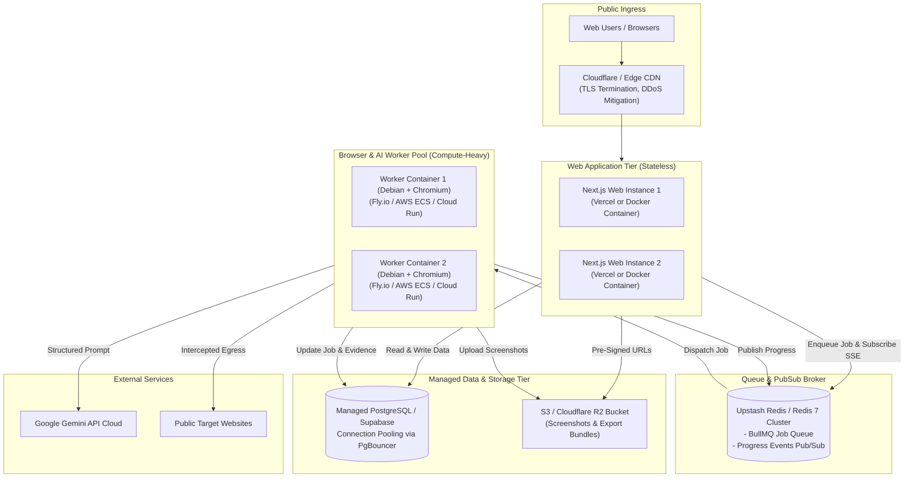

# RebuildIQ: Deployment Architecture & Multi-Environment Specification

## 1. Deployment Topology: Decoupling Web & Worker

A core architectural principle of RebuildIQ is that **the web application and the browser worker run as separate compute services**.

Headless Chromium browser automation is resource-intensive, requires native system libraries (`libnss3`, `libatk1.0-0`, `libxss1`, etc.), and consumes hundreds of megabytes of memory per active session. Serverless edge runtimes (e.g., Vercel, Netlify, Cloudflare Workers) cannot run Chromium reliably or maintain long-lived execution loops.



---

## 2. Service Boundary Matrix: Web vs. Worker

| Capability / Function | Web Application Service | Browser & AI Worker Service | Communication Protocol |
|---|---|---|---|
| **User Authentication & Sessions** | Yes | No | N/A |
| **Dashboard UI & Component Views** | Yes | No | N/A |
| **URL Pre-Flight Validation** | Yes (Fast DNS check) | Yes (Deep socket check) | Direct invocation |
| **Job Submission & Enqueuing** | Yes (Producer) | No | Redis (BullMQ `queue.add()`) |
| **Real-Time Progress Streaming** | Yes (SSE server) | Yes (PubSub publisher) | Redis Pub/Sub (`PUBLISH`/`SUBSCRIBE`) |
| **Headless Chromium Execution** | **NO** | **YES** | Isolated container runtime |
| **SSRF Socket-Level Interception**| No | Yes | Playwright `page.route` |
| **DOM & Computed Style Extraction**| No | Yes | In-browser evaluation |
| **Screenshot Capture & Storage** | No | Yes (Uploads to S3/Disk) | S3 SDK / Local filesystem |
| **AI Blueprint Synthesis** | No | Yes (Invokes Gemini API) | HTTPS to Gemini API |
| **Antigravity Prompt Synthesis** | No | Yes | Pure TypeScript logic |
| **Database Read & Querying** | Yes (Prisma Client) | Yes (Prisma Client) | PostgreSQL TCP (port 5432) |
| **Artifact Export Bundling** | Yes (Assembles ZIP/JSON)| No | Reads from DB & Object Store |

---

## 3. Environment Specifications

### 3.1 Development Environment (Local Machine)
- **Goal:** Zero-friction, zero-cloud-cost local development with single-command startup.
- **Topology:**
  - Web & Worker: Run concurrently in the local Node.js environment (`npm run dev`).
  - Database: Local SQLite file (`prisma/dev.db`) managed via Prisma.
  - Queue: In-memory or local Docker Redis.
  - Storage: Local filesystem (`./storage/screenshots/`).
  - AI Provider: Mock provider or direct developer Gemini API key.

### 3.2 Testing / CI Environment (GitHub Actions)
- **Goal:** Deterministic, fast, reproducible automated testing with 100% test isolation.
- **Topology:**
  - Runtime: Node.js 22 LTS in GitHub Actions runner.
  - Database: In-memory SQLite (`file:memdb?mode=memory&cache=shared`).
  - Browser: Headless Chromium installed via Playwright CLI.
  - AI Provider: Strict Mock Provider (deterministic, zero-cost, schema-verified JSON).

### 3.3 Staging Environment
- **Goal:** Production-identical integration verification.
- **Topology:**
  - Web: Vercel or single Docker container on Fly.io (0.5 vCPU, 512MB RAM).
  - Worker: Single dedicated worker container on Fly.io (2 vCPU, 2GB RAM with Chromium).
  - Database: Managed PostgreSQL (Supabase free/pro tier or Neon serverless).
  - Queue: Upstash Redis (serverless Redis with REST & TCP support).
  - Storage: Cloudflare R2 or Supabase Storage bucket.
  - AI Provider: Google Gemini API (pay-as-you-go).

### 3.4 Production Environment
- **Goal:** High availability, automated horizontal scaling, robust error recovery, and sub-second UI responses.
- **Topology:**
  - Web Cluster: Auto-scaling stateless Node.js containers (1–4 instances, 1 vCPU, 1GB RAM) behind Cloudflare CDN.
  - Worker Pool: Auto-scaling worker container group (1–8 instances, 2 vCPU, 4GB RAM) triggered by Redis queue length metrics.
  - Database: High-Availability PostgreSQL with connection pooling (PgBouncer) and automated backups.
  - Queue: Highly available Redis instance (Upstash or AWS ElastiCache).
  - Object Storage: Amazon S3 or Cloudflare R2 with custom domain and pre-signed URL security.
  - AI Provider: Google Gemini 2.5 API with production quota.

---

## 4. Containerization & Dockerfile Specifications

### 4.1 Browser Worker Dockerfile (`worker.Dockerfile`)
```dockerfile
# Multi-stage production container for Playwright Browser Worker
FROM node:22-bullseye-slim AS base

# Install Chromium system dependencies
RUN apt-get update && apt-get install -y --no-install-recommends \
    chromium \
    libnss3 \
    libatk1.0-0 \
    libatk-bridge2.0-0 \
    libcups2 \
    libdrm2 \
    libxkbcommon0 \
    libxcomposite1 \
    libxdamage1 \
    libxfixes3 \
    libxrandr2 \
    libgbm1 \
    libpango-1.0-0 \
    libcairo2 \
    libasound2 \
    ca-certificates \
    fonts-liberation \
    && rm -rf /var/lib/apt/lists/*

ENV PLAYWRIGHT_SKIP_BROWSER_DOWNLOAD=1
ENV PLAYWRIGHT_CHROMIUM_EXECUTABLE_PATH=/usr/bin/chromium

WORKDIR /app

COPY package*.json ./
COPY prisma ./prisma/

RUN npm ci --production=false
RUN npx prisma generate

COPY . .

RUN npm run build:worker

USER node

CMD ["node", "dist/worker/index.js"]
```

---

## 5. Scaling Strategy & Operating Cost Models

### 5.1 Autoscaling Triggers
- **Web App:** Scales based on CPU utilization (> 70%) and incoming HTTP request volume.
- **Worker Pool:** Scales based on BullMQ queue depth:
  $$\text{Target Workers} = \left\lceil \frac{\text{Queue Depth}}{\text{Concurrency per Worker (2)}} \right\rceil$$
  Scaled up automatically when jobs wait > 10 seconds; scaled down to baseline when queue is empty for > 5 minutes.

### 5.2 Operating Cost Projections

| Infrastructure Tier | Workload Volume | Component Breakdown | Estimated Monthly Cost |
|---|---|---|---|
| **Tier 1 (MVP / Beta)** | Up to 500 jobs / month | - Supabase Free Tier (Postgres)<br>- Upstash Redis Free Tier<br>- Fly.io 1x Worker ($5/mo)<br>- Gemini API Flash (~$5/mo)<br>- Cloudflare R2 Free Tier | **~$10 – $20 / month** |
| **Tier 2 (Growth)** | 5,000 jobs / month | - Managed Postgres Pro ($25/mo)<br>- Upstash Redis Pay-per-request ($10/mo)<br>- 2x Worker Nodes ($20/mo)<br>- Gemini API Flash ($25/mo)<br>- S3/R2 Storage ($5/mo) | **~$85 / month** |
| **Tier 3 (Enterprise)** | 50,000 jobs / month | - HA Postgres Cluster ($100/mo)<br>- Dedicated Redis ($40/mo)<br>- Auto-scaled Workers ($150/mo)<br>- Gemini API Pro/Flash ($200/mo)<br>- S3 + CDN ($30/mo) | **~$520 / month** |
