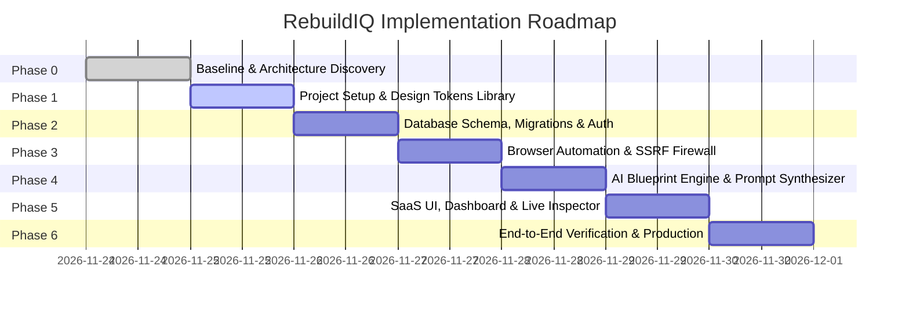

# RebuildIQ: Implementation Roadmap & Execution Plan

## 1. Roadmap Overview & Phased Strategy

RebuildIQ is being engineered in strict compliance with the Master Control Prompt. Every phase must establish working code, executed automated checks, security review, updated documentation, and an explicit verification report before transitioning to the next phase.

---

## 2. Phase-by-Phase Deliverables & Acceptance Criteria

### Phase 0: Project Baseline, Architecture & Threat Model (Current)
- [x] **0.1:** Inspect workspace, toolchains (Node v22, NPM 10, Git).
- [x] **0.2:** Initialize Git repository and production `.gitignore`.
- [x] **0.3:** Author Product Requirements Document (`docs/PRODUCT_REQUIREMENTS.md`).
- [x] **0.4:** Author Project Architecture Specification (`docs/PROJECT_ARCHITECTURE.md`).
- [x] **0.5:** Author Security Threat Model (`docs/SECURITY_THREAT_MODEL.md`).
- [x] **0.6:** Author Technical Decisions & Default Proposals (`docs/TECHNICAL_DECISIONS.md`).
- [x] **0.7:** Author Implementation Roadmap (`docs/IMPLEMENTATION_ROADMAP.md`).
- [x] **0.8:** Establish Project Status Tracker (`PROJECT_STATUS.md` & `docs/PROJECT_STATUS.md`).
- [x] **0.9:** Create `.env.example` documenting secrets conventions.
- [x] **0.10:** Commit baseline to Git and produce Phase 0 verification report.

### Phase 1: Project Setup, Strict Design Tokens & Base Component Library
- **Goal:** Establish a runnable, type-safe Next.js 15 + React 19 application configured strictly with brand design tokens and reusable UI primitives.
- **Deliverables:**
  - `package.json` with locked dependencies (Next.js 15, React 19, TypeScript 5.6, Tailwind CSS 3.4, Lucide React, Zod, Vitest).
  - `tailwind.config.ts` enforcing Navy (`#14213D`), Cream (`#F4EDE0`), and Coral (`#FF6B5B`) tokens.
  - `app/globals.css` with CSS custom properties and WCAG AA contrast pairings.
  - Reusable UI primitives: `Button`, `Input`, `Card`, `Badge`, `Alert`, `Tabs`, `SkeletonLoader`.
  - Vitest test setup and unit test suite verifying component rendering and token values.
- **Verification Rule:** `npm run build` compiles with zero errors; `npm test` executes and passes all UI tests.

### Phase 2: Database Layer, Schema Migrations & Multi-Tenant Authentication
- **Goal:** Implement persistent data models and secure session-based authentication with strict row-level authorization.
- **Deliverables:**
  - Prisma schema (`prisma/schema.prisma`): `User`, `Session`, `AnalysisJob`, `PageEvidence`, `VisualScreenshot`, `BlueprintArtifact`.
  - SQLite database for deterministic local testing with PostgreSQL production migration compatibility.
  - Password hashing (Argon2 / PBKDF2), session token generator with HTTP-only cookies.
  - Auth route handlers (`/api/auth/register`, `/api/auth/login`, `/api/auth/logout`, `/api/auth/me`).
  - Server-side authorization middleware enforcing user data isolation.
  - Automated tests for registration, authentication, and cross-user data isolation.
- **Verification Rule:** Automated tests verify session lifecycle and guarantee User B cannot access User A's jobs.

### Phase 3: Secure Browser Automation Engine & SSRF Firewall
- **Goal:** Build the controlled Playwright browser inspection worker with pre-flight DNS pinning and request-level interception.
- **Deliverables:**
  - SSRF Firewall (`lib/security/ssrf.ts`): IPv4/IPv6 resolver, CIDR blocklist (RFC 1918, 3927, loopback, cloud metadata), port whitelist.
  - Headless Chromium sandboxed launcher (`lib/browser/launcher.ts`).
  - Network route interception verifying IP on every hop and redirect.
  - DOM & computed style extractor (`lib/browser/extractor.ts`): typography, colors, spacing, layout containers.
  - Multi-viewport screenshot capture (`375px`, `768px`, `1280px`).
  - Automated test suite verifying SSRF blocklist and style extraction accuracy.
- **Verification Rule:** Automated security test suite proves private/internal IP requests are 100% blocked; browser extracts styles from sample pages without throwing errors.

### Phase 4: AI Analysis Engine, Structured Blueprint Generator & Prompt Synthesizer
- **Goal:** Implement the AI blueprint synthesizer that transforms observed evidence into structured reconstruction blueprints and Antigravity prompt packs.
- **Deliverables:**
  - AI Client abstraction (`lib/ai/client.ts`): Google Gemini structured output provider with fallback mock provider for offline testing.
  - Prompt injection defense: Data encapsulation within `<untrusted_web_evidence>` tags and strict Zod schema validation.
  - Blueprint Synthesizer (`lib/ai/blueprint.ts`): Component hierarchy, design tokens, state specs, modern tech stack recommendation.
  - Antigravity Prompt Pack Generator (`lib/ai/prompts.ts`): Phased, actionable markdown prompts ready for AI coding tools.
  - Automated tests validating schema adherence and prompt injection resilience.
- **Verification Rule:** Structured outputs conform 100% to Zod schemas; prompt generation produces complete multi-phase Antigravity instructions.

### Phase 5: SaaS UI, Dashboard, Live Job Inspector, Artifact Review & Export
- **Goal:** Deliver the complete user-facing SaaS experience matching the brand aesthetic.
- **Deliverables:**
  - Main Dashboard (`/dashboard`): Active jobs, historical analyses, quick submit.
  - URL Submission Experience (`/analysis/new`): Viewport toggles, crawl options, real-time validation.
  - Live Analysis Inspector (`/analysis/[id]`): Server-Sent Events (SSE) live progress bar, step indicators.
  - Split-view Evidence Inspector: Side-by-side comparison of observed DOM/CSS facts vs. AI blueprint inferences.
  - Blueprint Editor & Antigravity Prompt Exporter (one-click copy, JSON download, markdown export, ZIP bundle).
  - Responsive layouts, accessible contrast, empty/loading/error states.
- **Verification Rule:** Complete manual and automated user workflow walkthrough from URL submission to prompt export.

### Phase 6: End-to-End Verification, Security Audit & Production Deployment
- **Goal:** Perform full regression testing, security verification, containerization, and production readiness documentation.
- **Deliverables:**
  - End-to-end integration test suite covering the entire analysis lifecycle.
  - Multi-stage Dockerfile (`Dockerfile` & `docker-compose.yml`) with Chromium runtime dependencies.
  - Production deployment runbook (`docs/DEPLOYMENT.md`).
  - Final project status report with zero unresolved blocking issues.
- **Verification Rule:** Docker container builds and boots; automated test suite passes with 100% success; all security controls verified.
