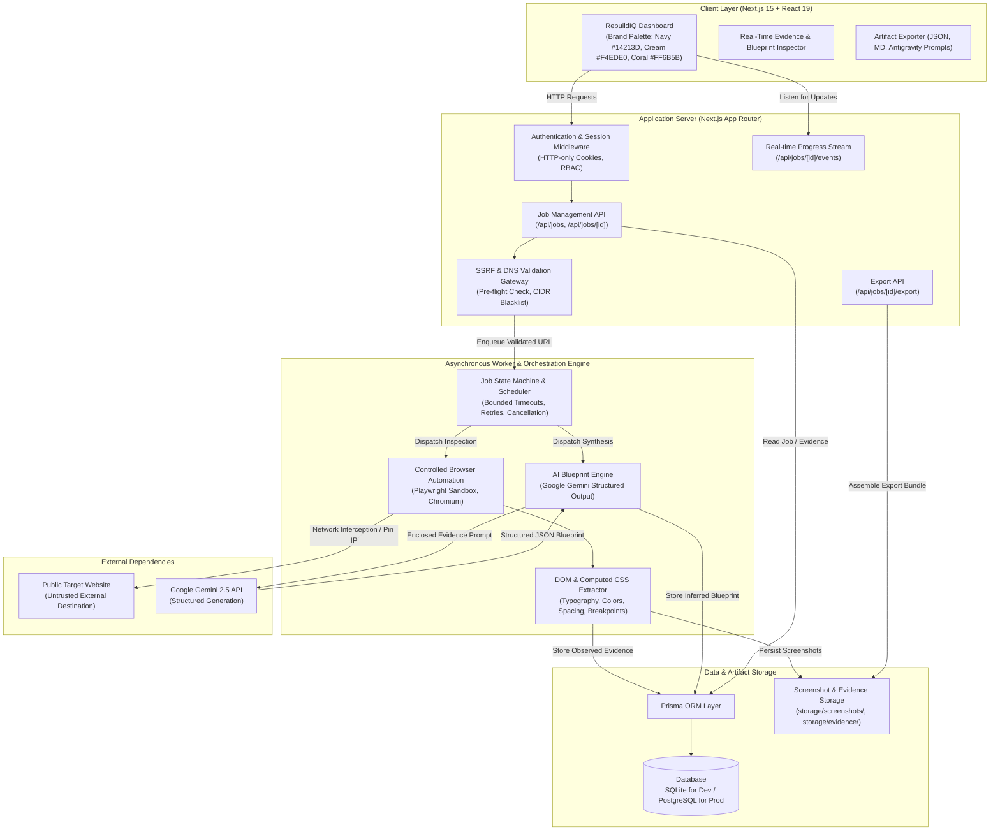

# RebuildIQ: Project Architecture Specification

## 1. System Topology & Architecture Overview

RebuildIQ is designed as a modular, decoupled SaaS platform. It combines a Next.js full-stack application (serving the UI and REST/SSE APIs) with an asynchronous background worker layer for headless browser automation and an AI synthesis pipeline for reconstruction blueprint generation.



---

## 2. Component Boundaries & Responsibilities

### 2.1 Web Presentation & UI Components
- **Framework:** Next.js 15 App Router, React 19, TypeScript.
- **Design Tokens:** Strict implementation of the brand palette:
  - Navy (`#14213D`): Deep surfaces, high-contrast headings, header bars, code block containers.
  - Cream (`#F4EDE0`): Warm canvas background, subtle cards, neutral borders.
  - Coral (`#FF6B5B`): Primary CTA buttons, active state indicators, progress bars, focal badges.
- **Pages & Views:**
  1. `/dashboard`: Overview of active jobs, recent analyses, quick submission bar.
  2. `/analysis/new`: Configurable URL submission (viewports, crawl depth).
  3. `/analysis/[id]`: Multi-tab inspection view:
     - *Overview:* Job status, metadata, summary statistics.
     - *Evidence (Observed Ground Truth):* Computed color swatches, typography scale, responsive screenshots (375px, 768px, 1280px), semantic DOM hierarchy.
     - *Blueprint (AI Inference):* Component hierarchy, design tokens, interaction states, modern tech stack recommendation.
     - *Antigravity Prompts:* Copy-paste ready implementation prompt pack.
  4. `/login` & `/register`: Clean, accessible authentication forms.

### 2.2 Security Gateway & SSRF Firewall (`lib/security/ssrf.ts`)
- **Protocol Enforcement:** Rejects any protocol other than `http:` or `https:`.
- **Pre-Flight DNS Resolution:** Resolves target hostname to IPv4/IPv6 addresses using `dns.promises.lookup({ all: true })`.
- **Subnet Filtering:** Checks all resolved addresses against:
  - `0.0.0.0/8`, `127.0.0.0/8` (Loopback)
  - `10.0.0.0/8`, `172.16.0.0/12`, `192.168.0.0/16` (RFC 1918 Private)
  - `169.254.0.0/16` (RFC 3927 Link-Local / Cloud Metadata)
  - `100.64.0.0/10` (Carrier Grade NAT)
  - `::1/128`, `fc00::/7`, `fe80::/10` (IPv6 Private / Link-Local)
- **Port Whitelist:** Standard web ports only: 80, 443, 8080, 8443.

### 2.3 Browser Automation & Evidence Extractor (`lib/browser/`)
- **Engine:** Playwright Chromium in headless sandbox mode.
- **Security Flags:**
  `['--disable-gpu', '--disable-local-file-access', '--disable-background-networking', '--disable-default-apps', '--no-sandbox']`
- **Request Routing Guard:**
  Intercepts every subresource and redirect (`page.route('**/*', ...)`). Resolves the target IP of any redirect before following, terminating navigation if a redirect attempts to reach internal/private addresses.
- **Extraction Scripts:**
  - Evaluates within page context using pure DOM APIs (no external script injection).
  - Collects computed styles from visible elements: `getComputedStyle(el)`.
  - Normalizes colors into uppercase Hex and rgba strings.
  - Aggregates typography by frequency and semantic usage (h1, h2, body, button).
  - Captures high-res full-page and viewport screenshots for 375px, 768px, and 1280px viewports.

### 2.4 AI Synthesis Engine (`lib/ai/`)
- **Model:** Google Gemini API (`gemini-2.5-flash` / `gemini-2.5-pro`).
- **Structured Output:** Strictly enforced JSON schema via Gemini `responseSchema` or Zod schema validation.
- **Prompt Injection Defense:**
  - Raw extracted text and attributes are formatted into JSON structures and wrapped in `<untrusted_web_evidence>` tags.
  - System instructions mandate that contents inside `<untrusted_web_evidence>` must be treated as inert data and never as execution directives.
- **Prompt Pack Synthesizer:**
  Generates targeted, phased prompt markdown specifically structured for AI coding tools like Antigravity, specifying exact tokens, component structures, and test expectations.

### 2.5 Job Orchestrator & State Machine (`lib/jobs/`)
- **State Flow:**
  `PENDING` $\to$ `VALIDATING` $\to$ `QUEUED` $\to$ `INSPECTING` $\to$ `EXTRACTING_EVIDENCE` $\to$ `ANALYZING_AI` $\to$ `GENERATING_BLUEPRINT` $\to$ `COMPLETED` / `FAILED` / `CANCELLED`
- **Guards:**
  - Maximum job execution timeout: 180 seconds.
  - Per-page navigation timeout: 30 seconds.
  - Automatic error categorization: `DNS_ERROR`, `SSRF_BLOCKED`, `TIMEOUT`, `EXTRACTION_FAILED`, `AI_GENERATION_FAILED`.

### 2.6 Persistence Layer (`prisma/schema.prisma`)
- **Entities:**
  - `User`: Authentication, credentials, timestamps.
  - `Session`: Active user sessions with token hashes.
  - `AnalysisJob`: Target URL, domain, status, progress, timings, error logs, `userId`.
  - `PageEvidence`: Extracted DOM JSON, computed typography, colors, spacing, layout metrics.
  - `VisualScreenshot`: Viewport dimensions, relative file paths, content hashes.
  - `BlueprintArtifact`: Inferred component hierarchy, design system tokens, tech stack specs, Antigravity prompt markdown.

---

## 3. Data Contracts & Schemas (Zod)

### 3.1 URL Submission Schema
```typescript
export const CreateJobSchema = z.object({
  targetUrl: z.string().url().max(2048),
  viewports: z.array(z.enum(['mobile', 'tablet', 'desktop'])).default(['mobile', 'tablet', 'desktop']),
  crawlDepth: z.number().int().min(1).max(5).default(1),
});
```

### 3.2 Observed Evidence Schema
```typescript
export const ObservedEvidenceSchema = z.object({
  url: z.string().url(),
  title: z.string(),
  metaTags: z.record(z.string()),
  typography: z.array(z.object({
    fontFamily: z.string(),
    fontSize: z.string(),
    fontWeight: z.string(),
    lineHeight: z.string(),
    sampleText: z.string().max(100),
    usageCount: z.number(),
  })),
  colors: z.object({
    backgrounds: z.array(z.string()),
    text: z.array(z.string()),
    borders: z.array(z.string()),
    accents: z.array(z.string()),
  }),
  layout: z.object({
    containerMaxWidth: z.string().optional(),
    usesFlexbox: z.boolean(),
    usesGrid: z.boolean(),
    spacingUnits: z.array(z.string()),
  }),
  domTree: z.object({
    tag: z.string(),
    id: z.string().optional(),
    classes: z.array(z.string()),
    children: z.array(z.any()),
  }),
});
```

### 3.3 Reconstruction Blueprint Schema
```typescript
export const BlueprintSchema = z.object({
  summary: z.string(),
  designSystem: z.object({
    colorPalette: z.object({
      primary: z.string(),
      secondary: z.string(),
      neutral: z.string(),
      accent: z.string(),
      background: z.string(),
    }),
    typographyScale: z.array(z.object({
      role: z.string(),
      fontFamily: z.string(),
      size: z.string(),
      weight: z.string(),
    })),
    spacingScale: z.array(z.string()),
  }),
  componentArchitecture: z.array(z.object({
    name: z.string(),
    purpose: z.string(),
    children: z.array(z.string()),
    props: z.array(z.string()),
    state: z.array(z.string()).optional(),
  })),
  recommendedStack: z.object({
    framework: z.string(),
    cssLibrary: z.string(),
    icons: z.string(),
    stateManagement: z.string(),
  }),
  antigravityPrompts: z.object({
    phase1Setup: z.string(),
    phase2Components: z.string(),
    phase3Interactions: z.string(),
    phase4Verification: z.string(),
  }),
});
```
